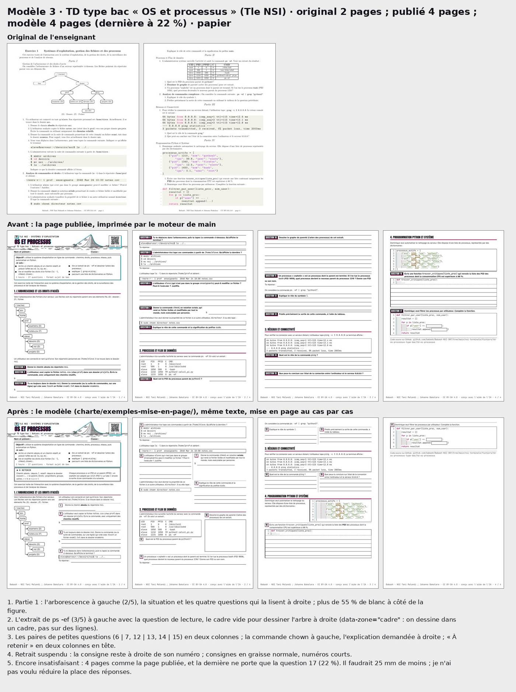
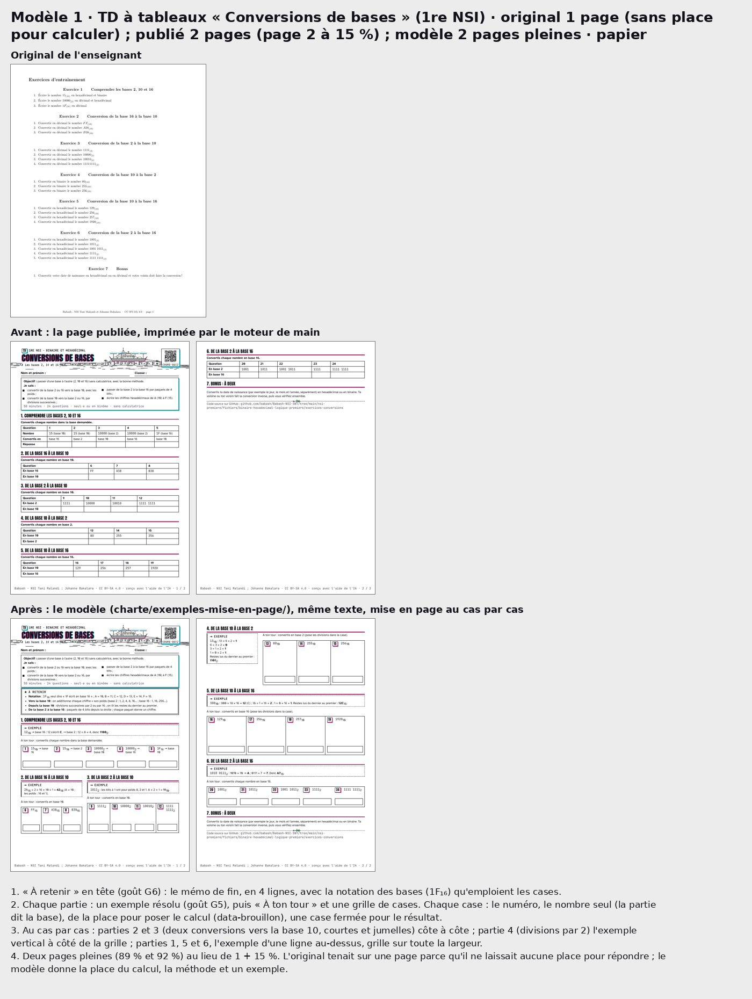
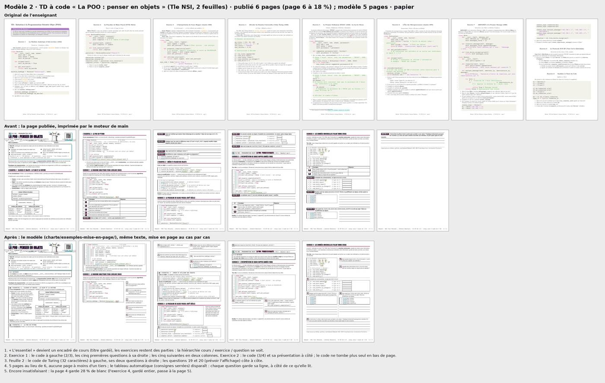

# Mettre en page un TD, cas par cas (guide des Ateliers, T140)

> « Les nouveaux TD ont une très mauvaise mise en page : leur mise en page doit être réfléchie au cas par cas, notamment en insérant des colonnes lorsque c'est pertinent. » (l'enseignant, 25/11)

Le moteur ne décide plus seul. Il donne des **moyens** ; l'Atelier **regarde la feuille rendue** et choisit, bloc par bloc, ce qui sert la lecture. Une page qui n'emploie aucun moyen garde exactement son rendu (écran et papier).

- Exemple de chaque moyen : [`mise-en-page.html`](mise-en-page.html) (à ouvrir, puis à imprimer).
- Trois TD refaits comme modèles : [`charte/exemples-mise-en-page/`](../exemples-mise-en-page/) (un TD à tableaux, un TD à code, un TD type bac).
- Mode d'emploi du moteur : [`LISEZMOI.md`](LISEZMOI.md).



## 1. Les principes

1. **Ce qui se lit ensemble est côte à côte.** Le code et les questions qui le lisent ; la figure et le texte qui en parle ; l'énoncé et le tableau à compléter ; l'exemple et la question « À ton tour ».
2. **Une question ne se sépare jamais de sa place pour répondre**, ni un titre de ce qui le suit.
3. **La place pour répondre est celle de la réponse écrite à la main** : ni une case où rien ne tient, ni une demi-page pour un mot. On dessine dans un cadre, on écrit sur des lignes.
4. **Pas de page presque vide**, pas de grand blanc à côté d'une figure étroite ou d'un code étroit.
5. **La hiérarchie se voit** : partie (h2), exercice (h3), question ; le cours (« L'essentiel », « À retenir ») est un encadré, pas une partie.
6. **Rien n'est répété** : un code est imprimé une fois, et lu à côté.
7. **L'écran aussi** : à 1440 px, un côte à côte s'élargit et le code reste visible pendant qu'on répond ; à 320 px, tout passe en une colonne, dans l'ordre de la page.
8. **Le goût de l'enseignant (25/11)** : un encadré « À retenir » de 5 à 8 lignes en tête de feuille (G6) ; un exemple résolu juste avant chaque question nouvelle, puis « À ton tour », sans coups de pouce (G5) ; une feuille = une séance d'une heure finie par un·e élève moyen·ne (G7) : un TD plus long devient plusieurs feuilles (`feuille-2.html`…), que l'Atelier découpe et signale.

## 2. Décider, bloc par bloc

```
Le bloc est…
├─ un code de 35 caractères ou moins (ou 44, 49, 57)  → côte à côte : le code | ses questions   (data-proportions 1/2, 3/5, 2/3, 3/4)
├─ un code plus large, ou une console longue           → toute la largeur ; ses questions dessous, en colonnes si elles sont courtes
├─ une figure étroite (arbre, grille, schéma)          → côte à côte : la figure | le texte et les questions qui la lisent (2/5, 1/3)
├─ un exemple résolu avant une question nouvelle       → à côté (exemple 2/5 | question) si la question est étroite ; au-dessus sinon
├─ 2 à 6 petites questions indépendantes               → td-colonnes (2 ou 3 colonnes)
├─ des conversions, des valeurs, des mots à trouver    → td-grille-reponses (cases, place pour le calcul : data-brouillon)
├─ un dessin à faire (arbre, graphe)                   → libre data-zone="cadre" (un cadre vide, pas des lignes)
├─ un rappel de cours                                  → td-encadre (retenir en tête de feuille ; rappel, methode, attention, exemple)
└─ rien de tout cela                                   → une colonne, comme avant
```

Puis : imprimer (`imprimer-td.py`), **regarder chaque page**, corriger. Les « Attention : mise en page » de l'outil montrent les défauts qui se mesurent ; le reste se voit.

## 3. Les moyens

| Moyen | Écriture | Écran | Papier |
|---|---|---|---|
| Côte à côte | `<div class="td-cote-a-cote" data-proportions="3/5"><div class="td-col">…</div><div class="td-col">…</div></div>` (proportion du **premier** bloc : `1/2` par défaut, `1/3`, `2/3`, `2/5`, `3/5`, `1/4`, `3/4`) | 1000 px et plus : deux colonnes, élargies jusqu'à 72rem ; le premier bloc reste visible (collant) s'il tient dans la fenêtre (`data-collant="non"` l'empêche). En dessous : une colonne, le premier bloc d'abord | deux colonnes, 6 mm entre elles ; le bloc reste sur une page (`data-coupable` pour le laisser passer d'une page à l'autre) |
| Colonnes | `<div class="td-colonnes" data-colonnes="2">` (2 par défaut, ou 3) autour de petites questions | 1000 px et plus : une grille, de gauche à droite (une question qui grandit ne saute pas de colonne) ; en dessous, une colonne | colonnes de journal : la première colonne, puis la deuxième ; `data-sens="lignes"` : de gauche à droite ; filet entre les colonnes ; entier sur une page (`data-coupable`) |
| Grille de réponses | `<div class="td-grille-reponses" data-colonnes="4" data-brouillon="2" data-etiquette-papier="non">` autour de questions `courte` | des cartes en grille (640 px et plus) | des cases : numéro et consigne en haut, place pour le calcul (`data-brouillon` lignes de 7 mm), une case fermée pour le résultat, alignées d'une case à l'autre ; un nombre ne se coupe jamais au milieu |
| Encadré | `<div class="td-encadre" data-genre="retenir">` (aussi `rappel`, `methode`, `attention`, `exemple`) ; un titre à soi : `<p class="td-encadre-titre">L'essentiel 1</p>` ; `data-colonnes="2"` | le titre (« À retenir », « Rappel »…) est un vrai mot, précédé d'un symbole (★ ■ ◆ ▲ →) ; le genre se lit au trait (double, épais, tirets), jamais à la seule couleur | trait noir fin, fond blanc ; entier sur une page, sauf s'il porte un code ou une figure |
| À ton tour | `data-a-ton-tour` sur la question qui suit un exemple résolu | une étiquette « À ton tour » à côté du numéro | idem |
| Exercice | `<section class="td-exercice"><h3 class="td-exercice-titre">Exercice 1 · …<span class="td-exercice-points">4 points</span></h3>…</section>` | un niveau entre la partie et la question (les questions deviennent des titres de niveau 4) | titre de 12 pt, souligné d'un filet, jamais seul en bas de page |
| Saut de page | `data-saut="avant"` ou `"apres"` sur n'importe quel bloc | rien | une nouvelle page, voulue |
| Garder ensemble | `data-ensemble` sur un bloc ; `data-avec-suivant` sur un paragraphe d'introduction | rien | le bloc reste sur une page ; le paragraphe reste avec ce qui le suit |
| Cadre à dessiner | `data-zone="cadre"` sur une `libre` (avec `data-lignes`) | rien (brouillon) | un cadre vide de `data-lignes` × 7 mm |
| Code compact | `data-numeros="non"` sur `pre.td-code` ; `data-compact` | sans numéros de ligne | environ 5 caractères de plus par ligne ; interligne serré (10 pt toujours) |
| Typographie revue | `data-mise-en-page="2"` sur `<main>` | rien | numéro court « 7 » dans un cadre, consigne en graisse normale et en retrait suspendu, filets fins entre les questions |

Automatique, sans rien écrire :
- une question placée dans un côte à côte, des colonnes ou une grille n'entre plus dans le tableau automatique « N° | Consigne | Réponse » et ne se coupe plus elle-même en deux (code | réponse) : l'Atelier a choisi sa place ;
- une `courte` dont la réponse modèle dépasse une ligne pleine reçoit deux lignes d'écriture, ou plus (`data-lignes="2"` le demande aussi) ;
- la numérotation suit l'ordre de la page : c'est l'ordre de lecture à l'écran, sur papier, au clavier et au lecteur d'écran.

### Combien de caractères de code tiennent dans une colonne (papier, 10 pt)

| Colonne | toute la largeur | 3/4 | 2/3 | 3/5 | 1/2 | 2/5 | 1/3 |
|---|---|---|---|---|---|---|---|
| avec numéros de ligne | 80 | 57 | 49 | 44 | 35 | 27 | 21 |
| `data-numeros="non"` | 85 | 61 | 54 | 49 | 40 | 32 | 26 |

`verifier-td.py` refuse une ligne de code ou de console trop longue pour sa colonne (elle passerait à la ligne) ; `imprimer-td.py` la mesure aussi dans le PDF.

## 4. Les cas types, en image

| Cas | Choix | Modèle |
|---|---|---|
| Un exercice de lecture de code (13 lignes, 45 caractères) et 10 petites questions | le code à gauche (2/3), les 5 premières questions à droite, les 5 suivantes en deux colonnes | [POO, exercice 1](../exemples-mise-en-page/poo/index.html) |
| Un code étroit (32 caractères) et deux questions sur ses lignes | 1/2 \| 1/2 | [POO, exercice 4](../exemples-mise-en-page/poo/feuille-2.html) |
| Une arborescence étroite et quatre questions qui la lisent | la figure (2/5) \| la situation et les questions | [OS et processus, partie 1](../exemples-mise-en-page/os-processus/index.html) |
| Un extrait de console et « dessine l'arbre » | la console (3/5) \| un cadre vide pour dessiner | OS et processus, partie 2 |
| 24 conversions | un exemple résolu, puis une grille de cases avec la place du calcul ; deux parties courtes et jumelles côte à côte | [Conversions](../exemples-mise-en-page/conversions/index.html) |
| Paires de questions courtes (justifier ; une commande) | deux colonnes | OS et processus, questions 6 et 7, 12 et 13, 14 et 15 |





## 5. Les erreurs à ne pas faire

- **Des colonnes partout.** Une consigne longue, un code large ou une réponse rédigée de plusieurs lignes ont besoin de la largeur. Une colonne de moins de 60 mm ne porte que des réponses d'un mot.
- **Un côte à côte déséquilibré** : un bloc trois fois plus haut que l'autre laisse un grand blanc. Changez la proportion, ou passez une question d'un bloc à l'autre (dans l'ordre de lecture).
- **Changer l'ordre des questions pour remplir un trou** : les numéros suivent la page ; le corrigé et la feuille en ligne aussi. On déplace des blocs, pas l'ordre des questions.
- **Couper le code pour qu'il tienne** dans une colonne trop étroite : élargissez la colonne, ou mettez le code sur toute la largeur.
- **Réimprimer un code** dans chaque question : un seul code, lu à côté.
- **Des lignes pour dessiner** : un cadre (`data-zone="cadre"`).
- **Un TP sur machine avec de grands cadres pour écrire le programme à la main** : sur papier, un TP donne les consignes et la place des réponses courtes ; le code s'écrit sur l'ordinateur (à voir avec l'enseignant·e, `data-support="ecran"` sur la question `code`).
- **Croire l'outil vert** : il ne voit ni un déséquilibre, ni une figure trop petite, ni une page laide. Regardez.

## 6. La liste de contrôle, page rendue sous les yeux

Imprimer la feuille (`imprimer-td.py`), ouvrir le PDF et le regarder **page par page**, puis l'écran à 1440, 768 et 320 px, en clair et en obscur.

- [ ] Chaque question est sur la même page que sa place pour répondre (outil : « sont séparées »).
- [ ] Aucun titre, aucune phrase d'introduction seul·e en bas de page (outil : « titre orphelin » ; une phrase : `data-avec-suivant`).
- [ ] Aucune page, sauf la dernière, avec plus d'un tiers de blanc en bas ; la dernière remplie au moins au tiers (outil : « de blanc en bas », « remplie à »). Sinon : changer une proportion, passer deux petites questions en colonnes, mettre un exemple à côté.
- [ ] Aucun grand blanc à côté d'une figure, d'un code ou d'une console étroite.
- [ ] Le code est entier sur sa ligne (outil : « trop longue pour sa colonne »), avec ses guides d'indentation.
- [ ] Chaque place pour répondre a la taille de la réponse écrite à la main (outil : « réponse à l'étroit ») ; un dessin a un cadre.
- [ ] La hiérarchie se lit en un coup d'œil : partie, exercice, question ; « À retenir » en tête.
- [ ] Rien n'est répété (code, consigne, étiquette qui redit la consigne).
- [ ] À l'écran large, le code reste visible pendant qu'on répond à côté ; à 320 px, une seule colonne, rien ne déborde, l'ordre est celui de la page.
- [ ] Au clavier (Tab), les champs viennent dans l'ordre des numéros.
- [ ] Le nombre de pages : celui d'une séance (4 au plus par feuille) ; dites-le, avec l'original, dans le rapport.
- [ ] Chaque choix de mise en page se justifie en une ligne dans le rapport.
